<p align="center">
  
</p>

<h1 align="center">Foreword</h1>

<p align="center">Autocomplete for everything you write on a Mac.<br>Free, unlimited, and entirely on your device.</p>

---

Foreword suggests the rest of your sentence as you type — in Mail, Messages, Slack, Notion, Google Docs, or any other text field — and shows it as gray text right where you're writing. Press <kbd>Tab</kbd> to take it a word at a time, <kbd>⇧</kbd><kbd>Tab</kbd> to take all of it, or just keep typing.

It runs a small language model on your Mac's GPU. There's no account, no subscription, no usage limit, and nothing you type is ever sent anywhere.

## Features

- **Works everywhere.** Native apps, Electron apps and web pages in Safari, Chrome, Arc, Edge, Brave, Firefox and Zen — anywhere macOS can tell it where your cursor is.
- **Predictions that fit.** Foreword reads the text around your cursor, what's on screen (the email you're replying to, the conversation above), the app and page you're in, what you've written before, and what you've told it about yourself.
- **Finishes words, phrases and sentences.** Mid-word completions, whole-phrase suggestions, and suggestions in the middle of a line.
- **Fixes typos.** When the word you just typed looks misspelled, Foreword offers the correction that fits the sentence.
- **Knows when to stay quiet.** It only suggests what it's reasonably sure of, never in password fields, and stays out of terminals, code editors and password managers unless you turn it on.
- **Placement that looks native.** Suggestions use the font, size and color of the text you're writing and sit on its baseline. Where inline text wouldn't make sense — in the middle of a line, or where the caret position is uncertain — they appear in a small card instead.
- **Fast.** About 36 ms per suggestion (50 ms at the 90th percentile) on an M5 Pro with the default model; older chips take longer. The model keeps its work between keystrokes, so each key press only processes what changed.

## Requirements

- A Mac with Apple silicon (M1 or later)
- macOS 14 Sonoma or later
- About 1.3 GB of disk space for the default model

## Install

1. Download the latest `Foreword.dmg` from [Releases](https://github.com/Mason363/Foreword/releases) and drag Foreword to Applications.
2. Open it and follow the setup: allow Accessibility access, then download a model.
3. Start typing anywhere.

## Using it

| Key | Action |
| --- | --- |
| <kbd>Tab</kbd> | Accept the next word |
| <kbd>⇧</kbd> <kbd>Tab</kbd> | Accept the whole suggestion |
| <kbd>Esc</kbd> | Dismiss |
| Keep typing | The suggestion follows along as long as it matches |

Punctuation after a word comes with the next press: "Monday." is accepted as "Monday", then ".". **Settings › Keyboard** can include it with the word instead, and all keys can be changed there. They're only taken over while a suggestion is showing.

**Exact placement in browsers** (Settings › Appearance, off by default): web pages only tell other apps where their text is to the nearest point, so in Chrome, Safari and web apps a suggestion can sit a pixel off. With this on, Foreword looks at the few characters just before your cursor once per line and lines the suggestion up exactly. It needs the Screen Recording permission; what it sees is compared with the suggestion's text in memory and never saved or sent anywhere.

**Settings** (menu bar icon › Settings…) lets you choose how often suggestions appear and how long they get, pick colors, turn Foreword off for specific apps or websites, describe yourself for more personal suggestions, and switch models.

## Models

Foreword uses *base* language models — models trained to continue text, not to chat — which is what makes suggestions sound like you instead of like an assistant.

| Option | Model | Size | Keystrokes saved* | Typical latency* |
| --- | --- | --- | --- | --- |
| Fast | Qwen3.5 0.8B (Q8_0) | 830 MB | 49% | 27 ms |
| Balanced (default) | Qwen3.5 2B (Q4_K_M) | 1.3 GB | 52% | 36 ms |
| Best | Qwen3.5 4B (Q4_K_M) | 2.7 GB | 57% | 79 ms |

\* Keystroke simulation with default settings on an M5 Pro; see "Measured quality" below.

Models are downloaded from Hugging Face on first run and checked against a SHA-256 hash. You can also choose your own GGUF base model in **Settings › Model**.

## Measured quality

From `foreword-eval sim`, which types sixteen pieces of everyday writing (emails, chats, essays, notes, a review, a recipe…) one key at a time and accepts a suggestion whenever it matches what comes next, with the default model and settings:

| | Fewer | Default | More |
| --- | --- | --- | --- |
| Keystrokes saved | 51% | 52% | 54% |
| Suggestions whose first word is right | 77% | 72% | 61% |
| Average suggestion length | 2.5 words | 2.8 words | 3.3 words |
| Suggestions longer than one word | 64% | 74% | 82% |
| Suggestions that are right word for word to the end | 34% | 26% | 14% |

Suggestions aim for a few words at a time, so a suggestion is often useful for its first words even when its ending differs from what you meant: take what fits with <kbd>Tab</kbd>, word by word, and keep typing.

The "How often" slider in Settings moves between these points.

## Known limitations

- Google Docs draws its text on a canvas and only shares it with other apps when its own accessibility support is on: in a document, turn on **Tools › Accessibility › Turn on screen reader support** and **Turn on braille support**. Foreword shows a reminder in Docs when they're off.

- Foreword needs the app to report where the text cursor is. Apps that draw their own text without exposing it to macOS (some canvas-based editors, games, remote desktops) don't get inline suggestions; where only the field is known, a floating card is used instead.
- Input methods that compose text (Pinyin, Kana…) pause suggestions while composing.
- Text you copied is used only if macOS lets Foreword read the clipboard without asking (Settings › Personal explains how to allow it).

## Privacy

- Inference runs locally with [llama.cpp](https://github.com/ggml-org/llama.cpp) on Metal.
- Foreword makes network requests only to download a model you choose.
- What you write is remembered in a local SQLite index (`~/Library/Application Support/Foreword/memory.sqlite`) so suggestions can reuse your names and phrasing. You can browse it, turn it off, or erase it in **Settings › Personal**.
- Password fields, secure input, and apps you exclude are never read.

## Building from source

Requires Xcode 16 or later and [XcodeGen](https://github.com/yonaskolb/XcodeGen).

```bash
brew install xcodegen
git clone https://github.com/Mason363/Foreword.git
cd Foreword
make            # generates the Xcode project and builds build/Release/Foreword.app
```

llama.cpp comes from its official Apple XCFramework release, pinned by version and checksum in `ForewordKit/Package.swift`; Swift Package Manager downloads it on the first build.

The prediction engine lives in `ForewordKit`, a Swift package with its own evaluation tool:

```bash
cd ForewordKit
swift build -c release
.build/release/foreword-eval cases <model.gguf>   # scenario report
.build/release/foreword-eval sim <model.gguf>     # keystroke simulation: savings, precision, latency
swift test
```

## How it works

1. **Reading the field.** Foreword follows keyboard focus through the Accessibility API, reads the text around the caret and asks the app where the caret is on screen. Chromium, Electron and Firefox build their accessibility trees on request, so Foreword switches them on.
2. **Building the prompt.** The prompt is the text before the cursor, preceded by a short header: app or website, window title, field label, nearby text on screen, related things you've written before, and your "About you" note.
3. **Predicting.** The partial word under the cursor is removed from the prompt and re-imposed as a byte-level constraint ("token healing"), so `the docu` completes to `ment` cleanly. Decoding is greedy and deterministic, with a penalty against repeating your own sentences back to you. The suggestion is cut at the last word the model is sure of and never ends on a dangling "and" or "the".
4. **Staying fast.** The model's state is cached between keystrokes. For attention models the cache is trimmed in place; for hybrid models like Qwen3.5 a few checkpoints are kept so that backspacing is cheap too.
5. **Showing it.** A single click-through overlay draws the text with the field's own font and baseline. When you type a character that matches the suggestion, the overlay shifts immediately instead of waiting for a new prediction, so nothing flickers.

## License

MIT. See [LICENSE](LICENSE). Model weights are distributed under their own licenses (Qwen3.5: Apache 2.0).
