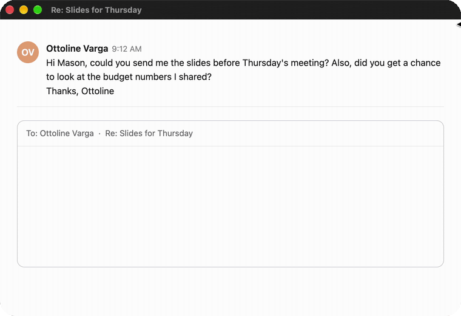
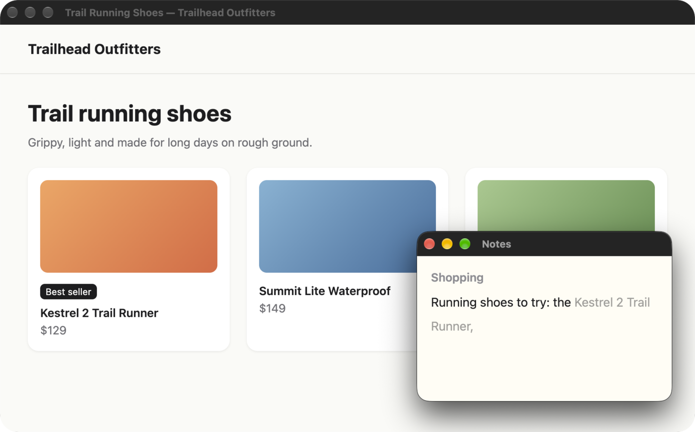
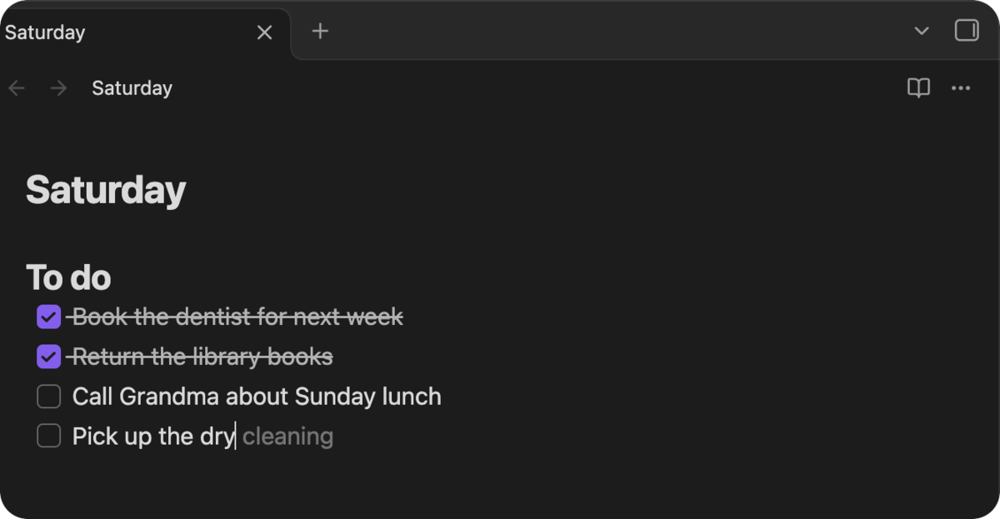
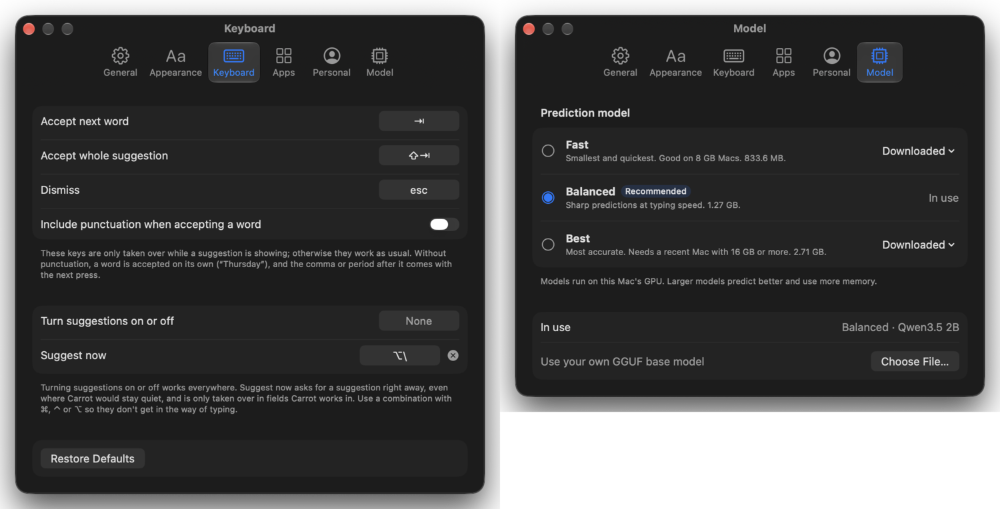

<p align="center">
  
</p>

<h1 align="center">Carrot</h1>

<p align="center"><b>Autocomplete for everything you write on a Mac.</b><br>Free, unlimited, and it never leaves your Mac.</p>

<p align="center">
  <a href="https://github.com/Mason363/Carrot/releases/latest"><b>Download for Mac</b></a> · macOS 14+ · Apple silicon
</p>

<p align="center">
  
</p>

<p align="center">
  <kbd>Tab</kbd> next word &nbsp;·&nbsp; <kbd>⇧</kbd> <kbd>Tab</kbd> all of it &nbsp;·&nbsp; <kbd>⌥</kbd> <kbd>\</kbd> suggest now &nbsp;·&nbsp; <kbd>Esc</kbd> dismiss
</p>

## Reads the room

<p align="center">
  
</p>

The email you're answering, the page behind your note, what you've written before: Carrot uses what's on your screen. Here, <kbd>⌥</kbd> <kbd>\\</kbd> asked for its best guess.

## Right where you write

<p align="center">
  
</p>

Gray text in the field's own font, on its baseline: Mail, Messages, Slack, Notion, Obsidian, Google Docs, Safari, Chrome, Arc, Firefox, Zen and Electron apps.

## Yours to tune

<p align="center">
  
</p>

Keys, how often and how long, colors, which apps and sites, and three models.

## Private

- Runs on your Mac's GPU. No account, no subscription, no limits.
- Goes online only to download the model you pick.
- Memory and the optional suggestion journal stay on your Mac. Browse, pause or delete them in **Settings › Personal**.
- Never reads password fields, secure input or apps you turn off.

## Install

1. [Download Carrot](https://github.com/Mason363/Carrot/releases/latest) and drag it to Applications.
2. Open it, allow Accessibility, pick a model.
3. Start typing.

> **Google Docs:** turn on **Tools › Accessibility › Turn on screen reader support** and **Turn on braille support**.

<details>
<summary><b>Models and measured quality</b></summary>

<br>

Base language models (trained to continue text, not to chat), so suggestions sound like you.

| | Model | Size | Keystrokes saved | Latency |
| --- | --- | --- | --- | --- |
| Fast | Qwen3.5 0.8B | 830 MB | 49% | 27 ms |
| **Balanced** | Qwen3.5 2B | 1.3 GB | 52% | 36 ms |
| Best | Qwen3.5 4B | 2.7 GB | 57% | 79 ms |

Measured with `carrot-eval sim`, which types pieces of everyday writing one key at a time and takes each suggestion that matches what comes next (M5 Pro). On a separate set of 104 pieces, the default saves 48% of keystrokes, 68% of suggestions start with the right word, and read by hand, about 94% are right or something a person could reasonably have written. Models download from Hugging Face and are checked against a SHA-256 hash; any GGUF base model works too.

</details>

<details>
<summary><b>Good to know</b></summary>

<br>

- Suggestions come with the next word's punctuation on the following <kbd>Tab</kbd>; **Settings › Keyboard** can change that and every key.
- **Exact placement in browsers** (Settings › Appearance) lines suggestions up to the pixel on web pages, using Screen Recording. What it sees is never saved.
- Apps that draw their own text without telling macOS where it is (some canvas editors, games, remote desktops) get a small card instead of inline text.
- Input methods that compose text (Pinyin, Kana…) pause suggestions while composing.
- Copied text is used only if macOS lets Carrot read the clipboard without asking.
- The suggestion journal (off by default) records what Carrot saw and suggested and what you wrote, for 30 days, in `~/Library/Application Support/Carrot/journal.sqlite`.

</details>

<details>
<summary><b>Build from source</b></summary>

<br>

Requires Xcode 16+ and [XcodeGen](https://github.com/yonaskolb/XcodeGen).

```bash
brew install xcodegen
git clone https://github.com/Mason363/Carrot.git
cd Carrot
make            # builds build/Release/Carrot.app
```

The engine is `CarrotKit`, a Swift package with its own evaluation tool:

```bash
cd CarrotKit
swift build -c release
.build/release/carrot-eval sim <model.gguf> --chain --check-words --docs Eval/corpus.json --log run.jsonl
python3 Eval/analyze.py Eval/corpus.json run.jsonl
swift test
```

llama.cpp comes from its official XCFramework release, pinned by checksum in `CarrotKit/Package.swift`.

</details>

<details>
<summary><b>How it works</b></summary>

<br>

1. **Reads the field** through the Accessibility API: the text around the caret and where the caret is on screen.
2. **Builds a prompt** from that text plus a short header: app, window, what's on screen and in the windows around it, related things you've written, and your "About you" note.
3. **Predicts** with a base model via [llama.cpp](https://github.com/ggml-org/llama.cpp) on Metal, re-imposing the half-typed word so `the docu` completes to `ment`, and cutting the suggestion at the last word it's sure of.
4. **Stays fast** by keeping the model's state between keystrokes.
5. **Draws** one click-through overlay in the field's font and baseline that moves with your typing without flicker.

</details>

## License

MIT. See [LICENSE](LICENSE). Model weights have their own licenses (Qwen3.5: Apache 2.0).
