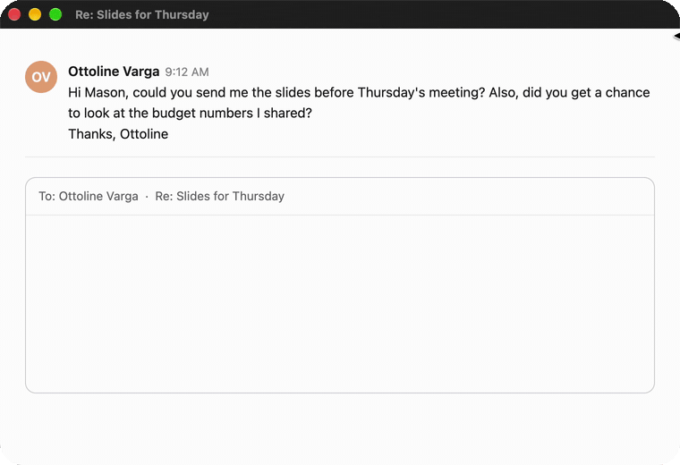

**Autocomplete for everything you write on a Mac.** Free, unlimited, and it never leaves your Mac.

- Gray suggestions right where you type, in the field's own font: <kbd>Tab</kbd> takes the next word, <kbd>⇧</kbd><kbd>Tab</kbd> all of it
- <kbd>⌥</kbd><kbd>\\</kbd> asks for a suggestion anywhere it stayed quiet
- Uses what's on screen: the email you're answering, the page behind your note, what you've written before
- Works in Mail, Messages, Slack, Notion, Obsidian, Google Docs, browsers and Electron apps
- Fixes typos, finishes words mid-word, and wraps long suggestions like the field does
- Runs on your Mac's GPU with Qwen3.5 base models via llama.cpp; nothing you type is sent anywhere

Requires a Mac with Apple silicon and macOS 14 or later. Open **Carrot-1.0.0.dmg** and drag Carrot to Applications.
